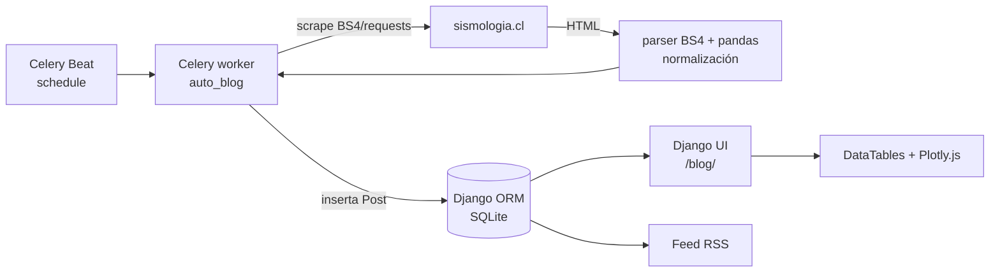

# Auto Blog

Blog automatizado de sismología para Chile: scrapea datos del sitio [sismologia.cl](https://www.sismologia.cl), los procesa y normaliza, y publica los sismos como posts de blog con visualización en DataTables + Plotly.js y feed RSS.

[](https://github.com/bi0punk/auto_blog/actions/workflows/ci.yml)
[](https://www.python.org/)
[](LICENSE)

## Contenido

- [Características](#características)
- [Arquitectura](#arquitectura)
- [Stack](#stack)
- [Estructura del repositorio](#estructura-del-repositorio)
- [Instalación](#instalación)
- [Uso](#uso)
- [Configuración](#configuración)
- [Tests / CI](#tests--ci)
- [Roadmap](#roadmap)
- [Licencia](#licencia)

## Características

- Scraping periódico de sismologia.cl vía Celery Beat.
- Procesamiento y normalización de datos (magnitude, lat/lon, UTC time).
- Publicación automática de sismos como posts de blog.
- Frontend con DataTables + Plotly.js para visualizar sismos.
- Feed RSS.

## Arquitectura



## Stack

- **Backend**: Django 5.1 (+ SQLite)
- **Task Queue**: Celery 5.4 + Redis (broker)
- **Scraping**: BeautifulSoup4 + Requests + Pandas
- **Frontend**: HTML5 + CSS + jQuery + DataTables + Plotly.js
- **Calidad**: ruff (lint), Django tests

## Estructura del repositorio

```
auto_blog/
├── manage.py
├── auto_blog/              # settings, celery, tasks (scraping), urls, tests
├── blog/                   # models (Post), views, migrations, templates, static
├── sismos_20240702.csv     # Dataset de ejemplo
├── .env.example
├── requirements.txt
├── pyproject.toml
└── .github/workflows/ci.yml
```

## Instalación

Requisitos: Python 3.12+, Redis (para Celery) y conexión a internet para el scraping.

```bash
git clone https://github.com/bi0punk/auto_blog
cd auto_blog
python -m venv .venv
source .venv/bin/activate
pip install -r requirements.txt

cp .env.example .env   # editar SECRET_KEY, ALLOWED_HOSTS
python manage.py migrate

# Redis
redis-server

# Celery (en terminales separadas)
celery -A auto_blog worker -l info
celery -A auto_blog beat -l info

# Servidor
python manage.py runserver
```

Visitar `http://localhost:8000/blog/`.

## Uso

1. Configura `.env` (ver [Configuración](#configuración)).
2. Arranca Redis + Celery worker + Celery beat + Django.
3. Celery Beat dispara el scraping según el schedule; los sismos nuevos se publican como posts.
4. Revisa el blog en `/blog/` y el feed RSS.

Datos de ejemplo en `sismos_20240702.csv`.

## Configuración

Variables en `.env` (ver `.env.example`):

| Variable | Default | Descripción |
|---|---|---|
| `DEBUG` | — | `True`/`False` |
| `SECRET_KEY` | — | Clave Django |
| `ALLOWED_HOSTS` | — | Hosts permitidos |
| `DATABASE_URL` | `sqlite:///db.sqlite3` | URL de la base de datos |
| `REDIS_URL` | `redis://localhost:6379/0` | Broker de Celery |

Datos: `db.sqlite3` (local, gitignored, se genera con `migrate`) y posts persistidos en la tabla `Post` del ORM.

## Tests / CI

```bash
DEBUG=True SECRET_KEY=test ALLOWED_HOSTS=localhost DATABASE_URL=sqlite://:memory: \
  python manage.py test blog auto_blog
```

Tests existentes: helpers de parsing (`_parse_float`, `_parse_lat_lon`, `_parse_utc_time`) en `auto_blog/tests.py` + tests del modelo `Post` en `blog/tests.py`.

CI: GitHub Actions (`.github/workflows/ci.yml`) sobre Python 3.12: **lint** (`ruff check .`) y **test** (`python manage.py check` + `python manage.py test blog auto_blog`, con SQLite in-memory, sin Redis).

## Roadmap

- [x] Scraping periódico con Celery Beat
- [x] Publicación automática de posts + feed RSS
- [x] Frontend con DataTables + Plotly.js
- [ ] Alertas por Telegram
- [ ] Tests del scraper con fixtures HTML
- [ ] Dashboard histórico

Limitación: depende del HTML de sismologia.cl; cambios en el sitio pueden romper el scraper. Sin tests end-to-end del scraper (requiere red).

## Licencia

MIT — ver [LICENSE](LICENSE).